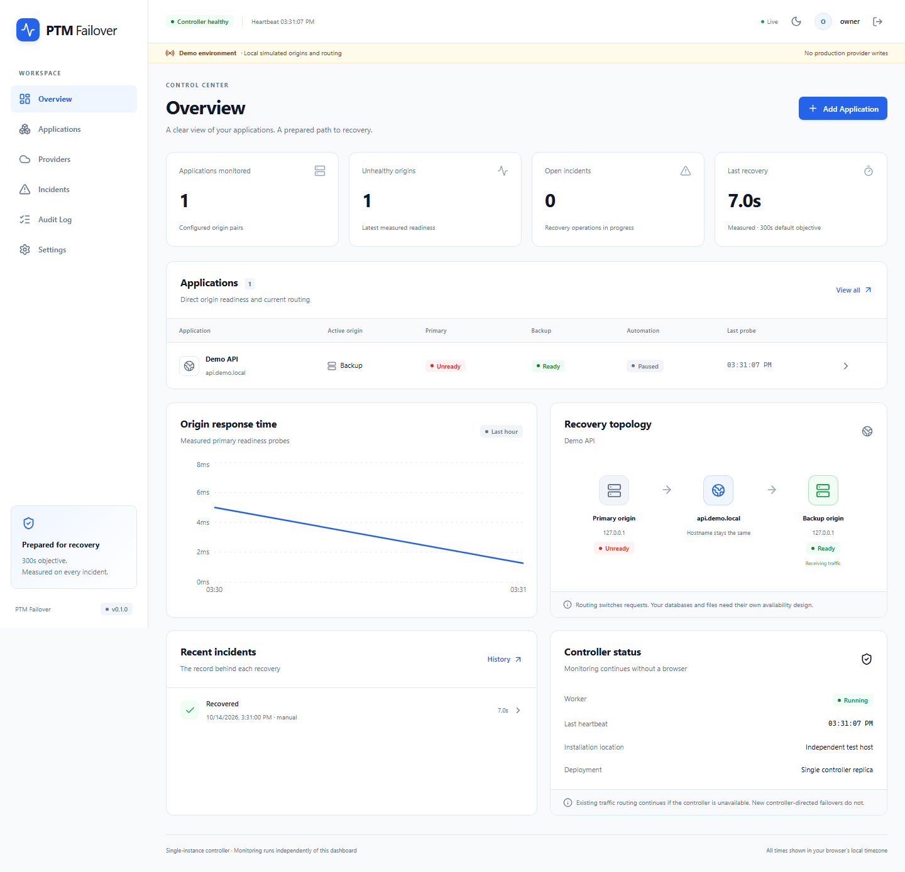

# PTM Failover

A self-hosted, single-owner application failover controller. It probes independently prepared origins, starts an existing backup when supported, validates readiness, changes an approved DNS record set, verifies public identity, and records measured recovery. The dashboard and authenticated API share port **8080**; monitoring runs without a browser.

The 300-second recovery objective is measurable, environment-dependent, and never a guarantee. Switching routing does not transfer databases, files, sessions, memory, running processes or WebSockets.



Implemented with Node.js 24 LTS, TypeScript 7, React 19, Vite 8, Tailwind CSS 4, Fastify 5 and SQLite. See the [verification record](docs/verification.md) for executed tests, screenshots and remaining Docker/live-provider checks.

## Local demo

Use **Node.js 24 LTS** and **pnpm 12.11.2**. Dependencies are pinned in `controller/package.json` and `controller/pnpm-lock.yaml`. Install pnpm using the [official installation guide](https://pnpm.io/installation), or use the included project-local integrity-checked bootstrap helper.

```sh
cd controller
pnpm install --frozen-lockfile
pnpm run demo
```

Open <http://localhost:8080>. Secret files are generated without printing their contents. Privately open `secrets/bootstrap-token` and use it to claim the installation with your own username and a password of at least 12 characters. There are no default credentials.

On Windows with Node installed through nvm but absent from PATH:

```powershell
$env:PATH = 'C:\nvm\v24.15.0;' + $env:PATH
Set-Location controller
node scripts/bootstrap-pnpm.mjs
.\.tools\pnpm\package\pnpm.exe install --frozen-lockfile
npm.cmd run demo
```

1. Select **Add Application** and follow the ten-step wizard. Choose a demo hostname such as `api.demo.local` and a release such as `v1`.
2. Demo origins and routing are generated locally. Declare the dependency checklist and run read-only preflight.
3. Finish with automation paused, or explicitly enable it. Operator confirmation is the conservative default.
4. Open the application. **Dry Run** reads a plan without provider or routing writes. **Simulate primary failure** changes the local fixture.
5. **Fail Over** opens the actual plan; **Confirm traffic change** creates a persisted incident. Inspect its timeline under Incidents.
6. To exercise automatic detection, set confirmation to **single-vantage**, save the policy, enable automation, then simulate failure. Multiple repeated checks are still one vantage point.
7. Restore the primary. It will not silently fail back. Reviewed manual failback requires the sustained readiness window.
8. Stop and restart the demo. Accounts, probes, application configuration, routing, incident deadlines and action intent remain in `data/demo`.

The demo is visibly labeled. It uses separate fake provider/router adapters and three loopback fixture HTTP listeners (primary, backup and public-route simulation) supervised within the same Node process. Demo installations reject real provider credentials and notifications. It demonstrates the controller logic, not live AWS/Hostinger/CDN availability.

## Development and checks

```sh
npm run dev              # Vite localhost:5173, API localhost:8080
npm run typecheck
npm run lint
npm test
npm run build
npx playwright install chromium
npm run test:e2e
npm run format:check
```

For a Vite demo development session, set `DEMO_MODE=true` and `DATA_DIR=data/demo` before `npm run dev`. Development defaults the mutation origin to `http://localhost:5173`. Run a single controller per data directory.

Runnable source lives in `controller/`, with `apps/web`, `apps/api`, and real shared `packages/contracts`, `packages/providers`, `packages/routing`, `packages/orchestrator` packages inside it. Run npm commands from `controller/`. Docker and Compose commands run from the repository root. The API publishes an authenticated OpenAPI document at `/api/v1/openapi.json`. Frontend and backend share Zod schemas and TypeScript types.

## Docker installation

No registry image is published by this repository. Build locally:

```sh
node controller/scripts/secrets.mjs
docker build -t ptm-failover:0.1.0 .
cp .env.example .env
docker compose up -d
```

On Linux, mounted files must be readable by the container's non-root UID **1000**. Preserve the master key. Do not overwrite it when upgrading.

```sh
sudo chown 1000:1000 secrets/master-key secrets/bootstrap-token
sudo chmod 700 secrets
sudo chmod 400 secrets/master-key secrets/bootstrap-token
```

The Compose service binds only `127.0.0.1:8080`, runs non-root, drops Linux capabilities, and has no Docker socket, host networking or privileged mode. It mounts `/data` and read-only secrets. For a remote first-run installation use:

```sh
ssh -L 8080:127.0.0.1:8080 user@controller-host
```

Open localhost over the tunnel. For routine access, place an HTTPS reverse proxy in front and set `APP_BASE_URL=https://controller.example.com`. Secure session cookies activate for HTTPS; localhost HTTP is the documented local exception. Do not expose an unauthenticated bootstrap page publicly. See [operations](docs/operations.md).

Docker demo:

```sh
node controller/scripts/secrets.mjs
# Apply the Linux secret ownership/permissions above when needed.
docker compose -f compose.demo.yaml --profile demo up --build
```

Build and publish to **your** registry after validation:

```sh
docker buildx build --platform linux/amd64,linux/arm64 \
  -t REGISTRY/OWNER/ptm-failover:VERSION --push .
```

Once that image exists, set `PTM_FAILOVER_IMAGE=REGISTRY/OWNER/ptm-failover:VERSION`, run `docker compose pull`, then `docker compose up -d`. Native SQLite/password-hashing packages must be smoke-tested on both architectures before advertising support. See [verification](docs/verification.md) for checks actually run.

## Production preparation

Read [application preparation](docs/application-preparation.md), [provider permissions](docs/providers.md), [operations](docs/operations.md) and [limitations](docs/limitations.md). Real adapter testing requires customer credentials and prepared resources; mocked contract tests are not proof of live recovery.

The controller belongs outside the primary failure domain. If it is down, existing routing continues but no new controller-directed failover occurs. A second controller requires a different shared-state/fencing design; sharing or copying SQLite is insufficient.
